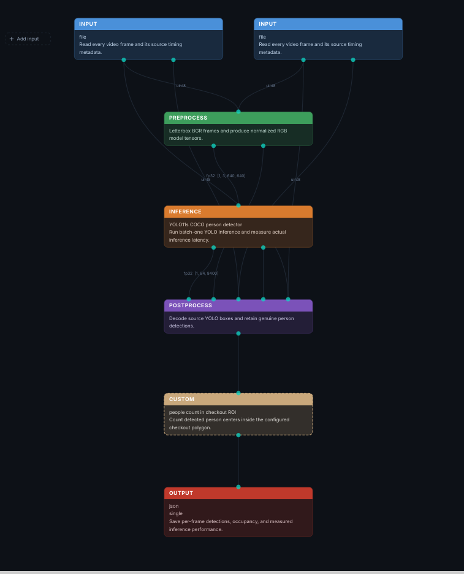

# SmartQueue AI
### Computer-Vision-Based Retail Queue Monitoring Prototype


**SmartQueue AI** is a computer-vision prototype designed to help retailers analyze people detected in recorded video. It uses an **NVIDIA DeepStream** inference pipeline with a **TensorRT FP16** model to process video frames, export structured detection metadata, and visualize the saved results through a lightweight **Flask** dashboard.

The project demonstrates an end-to-end workflow from video inference to structured data and dashboard visualization.

---

## 🎯 Problem Statement

Retailers need better visibility into customer queues and checkout activity. Manually reviewing video footage can be time-consuming.

SmartQueue AI explores how computer vision can extract person-detection information from video and present the results in a dashboard that is easier to understand than raw inference output.

---

## 🚀 Features

- **Video-based inference**: Processes a recorded retail video.
- **PipeGen pipeline**: Uses a PipeGen-created pipeline with NVIDIA DeepStream.
- **TensorRT optimization**: Uses a compiled TensorRT FP16 engine.
- **Person detection**: Exports detected-person labels, confidence scores, and bounding-box coordinates.
- **JSON metadata export**: Stores frame-by-frame detection results in JSON format.
- **Analytics dashboard**: Displays detection totals, frame statistics, confidence information, and a detection trend chart.
- **Local dashboard**: Uses Python and Flask to visualize previously exported results.

---

## 🏗️ System Architecture

```
Recorded Input Video
       │
       ▼
PipeGen Pipeline
       │
       ▼
NVIDIA DeepStream
       │
       ▼
TensorRT FP16 Inference (YOLO11s)
       │
       ▼
Person Detection Results
       │
       ▼
JSON Metadata Export (data/metadata_nms_test.json)
       │
       ▼
Python + Flask Dashboard (app.py)
       │
       ▼
Detection Statistics and Interactive Charts
```

> [!NOTE]
> The dashboard reads saved JSON metadata. It does not currently run inference or receive live detections from the pipeline.

### Pipeline Flow Graph

The end-to-end computer vision and analytics pipeline was constructed and compiled using **PipeGen**:



1. **Input**: Read every video frame and its source timing metadata.
2. **Preprocess**: Letterbox BGR frames and produce normalized RGB model tensors (`fp32 [1, 3, 640, 640]`).
3. **Inference**: YOLO11s COCO person detector running batch-1 inference with real-time latency measurement.
4. **Postprocess**: Decode source YOLO boxes and retain genuine person detections with Non-Maximum Suppression (NMS).
5. **Custom Logic**: People count in checkout ROI — count detected person centers inside the configured checkout polygon.
6. **Output**: Save per-frame detections, occupancy, and measured inference performance to single JSON.

---

## 🎥 Pipeline Demonstration & Benchmarks

Execution of the PipeGen pipeline showing compilation, real-time latency tracking, run summary logs, and standalone project export:

<video src="assets/pipeline-demo.mp4" controls="controls" width="100%">
  Your browser does not support the video tag.
</video>

> 📹 *Can't play the video above? [Click here to view or download the demo video directly](assets/pipeline-demo.mp4).*

---

## 💻 Technology Stack

| Component | Technology |
| :--- | :--- |
| **Pipeline development** | PipeGen |
| **Video inference** | NVIDIA DeepStream |
| **Model inference** | TensorRT FP16 |
| **Detection model** | YOLO11s-based person detection |
| **Backend / dashboard** | Python, Flask |
| **Data format** | JSON |
| **GPU inference hardware** | NVIDIA RTX 3050 6 GB used during development |
| **Development environment** | Ubuntu on WSL2 and Docker |

---

## 📊 Test Results

The recorded-video pipeline completed a test run with the following results:

| Metric | Result |
| :--- | :--- |
| **Frames processed** | 232 |
| **Detection objects exported** | 1,193 |
| **Pipeline execution time** | Approximately 9.24 seconds |
| **Average exported detections per frame** | Approximately 5.14 |
| **Metadata output** | JSON |
| **Inference engine** | TensorRT FP16 |

> [!IMPORTANT]
> - These measurements describe the recorded test run, not guaranteed performance on other hardware or input videos.
> - The output count represents detected objects after the configured post-processing. It should not be interpreted as a validated customer queue count.

---

## 📂 Project Structure

```
smartqueue-ai/
├── app.py                      # Flask backend and API endpoints
├── requirements.txt            # Python dependencies (Flask)
├── README.md                   # Project documentation
├── assets/
│   ├── pipeline-architecture.png # PipeGen CV pipeline architecture diagram
│   └── pipeline-demo.mp4       # Video demonstration of pipeline execution
├── templates/
│   └── index.html              # Modern dark-mode dashboard UI & chart
├── data/
│   └── metadata_nms_test.json  # Precomputed CV detection metadata
└── .venv/                      # Local virtual environment (optional)
```

- The PipeGen/DeepStream project and TensorRT engine are maintained separately from the lightweight Flask dashboard.
- The metadata file must be present at `data/metadata_nms_test.json` for the dashboard to display the supplied test results.

---

## ⚙️ Requirements

### For the Dashboard:
- Python 3.10+
- `pip`
- The project files listed above
- The exported JSON metadata file (`data/metadata_nms_test.json`)

> 💡 *A GPU is not required to view the saved results in the dashboard.*

### For Running the Inference Pipeline:
- Compatible NVIDIA GPU (e.g. RTX 3050 6GB or higher)
- NVIDIA DeepStream SDK and compatible container / runtime setup
- Compiled TensorRT FP16 engine

---

## 🚀 Run the Dashboard

### 1. Clone or Copy the Project
Place the project folder on your computer. Ensure that the `templates/` directory and `data/metadata_nms_test.json` file are included.

### 2. Open a Terminal in the Project Directory
```bash
cd smartqueue-ai
```

### 3. Create a Virtual Environment
```bash
python -m venv .venv
```

### 4. Activate the Environment
- **Ubuntu / Linux / macOS:**
  ```bash
  source .venv/bin/activate
  ```
- **Windows PowerShell:**
  ```powershell
  .venv\Scripts\Activate.ps1
  ```

### 5. Install Dependencies
```bash
python -m pip install --upgrade pip
pip install -r requirements.txt
```

### 6. Start the Dashboard
```bash
python app.py
```

### 7. Open the Dashboard
Visit:
[http://127.0.0.1:5000](http://127.0.0.1:5000)

The dashboard displays the previously exported metadata. To view new inference results, run the inference pipeline separately and replace the metadata file with the new output.

---

## ⚡ Run the Inference Pipeline

The PipeGen/DeepStream pipeline is maintained in the separate PipeGen project environment. Its execution requires the corresponding project configuration, custom parser libraries, model files, TensorRT engine, and compatible DeepStream container/runtime.

> [!WARNING]
> The compiled TensorRT engine is hardware- and software-environment-dependent. It should not be assumed to work on a CPU-only laptop. The dashboard alone does not reproduce the inference pipeline.

---

## ⚠️ Current Limitations

- **Recorded Video Only**: The current demonstration uses recorded video, not a live camera feed.
- **ROI Scope**: The current ROI configuration uses whole-frame detection rather than a validated checkout-zone polygon.
- **No Person Tracking**: Person tracking and persistent customer identities are not implemented in the current output.
- **Raw Detections vs Queue Counts**: Detection totals are not equivalent to verified queue occupancy.
- **Static Metadata**: The dashboard visualizes saved metadata and does not update automatically from live inference.
- **Hardware Variance**: Performance may vary with GPU hardware, video resolution, model configuration, and runtime environment.

---

## 🔮 Future Improvements

- [ ] Configure checkout-specific regions of interest (ROIs).
- [ ] Integrate person tracking across frames.
- [ ] Calculate queue occupancy within configured checkout zones.
- [ ] Add queue-length and waiting-time estimates after appropriate validation.
- [ ] Connect the dashboard to continuously updated inference results.
- [ ] Add live-camera integration and operational alerts.
- [ ] Evaluate accuracy and performance across additional retail scenarios.

---

## 🔄 Reproducibility

- **Dashboard demonstration**: Include the application source (`app.py`), HTML template (`templates/index.html`), requirements file (`requirements.txt`), and exported JSON metadata (`data/metadata_nms_test.json`).
- **Inference pipeline run**: Provide the PipeGen project/export, pipeline configuration, model assets or permitted download instructions, and compatible DeepStream / TensorRT runtime setup.
- *Note*: Do not commit large model files, credentials, or other sensitive information to a public repository.

---

## 🎯 Project Goal & Status

SmartQueue AI demonstrates a foundation for turning video-based person detections into structured metadata and visual analytics for retail queue-monitoring use cases.

- **Status**: Working prototype — recorded-video inference, JSON export, and saved-results dashboard.
- 🏆 **Built for the CraftifAI / PipeGen Buildathon.**
